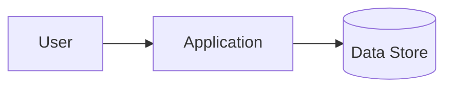

# Project Steward Templates

Use the heading index to select one needed skeleton. Keep only fields that serve the task; do not read or create every artifact. Markdown responsibilities are defined in `project-files.md`.

## Template Index

Open/copy only the template matching a document that is actually needed. Remove unused fields. Paths in skeletons are placeholders to replace with verified existing targets, not documents to generate in bulk.

| Need | Template | Boundary |
| --- | --- | --- |
| Core project instructions and direct routes | [AGENTS](#agentsmd-template) | Project-specific constraints, not a copied skill manual. |
| Navigation for a larger doc set | [Context index](#context-index-template) | Routes to facts, not repeated facts. |
| Find code ownership | [Project map](#project-map-template) | Responsibilities and entrypoints, not a complete tree. |
| Planned work and missing evidence | [Work plan](#work-plan-template) | Current scope and next questions. |
| Project process history | [Daily log](#daily-project-log-template) | Short chronology and evidence pointers. |
| Durable choice | [ADR](#adr-template) | Rationale and consequences. |
| Focused redesign | [Refactor plan](#redesign--refactor-plan-template) | Affected boundary and migration. |
| Current system relationships | [Architecture](#architecture-overview-template) | Flows and invariants; link to code owners. |
| Resume a specific run | [Handoff](#handoff-template) | Current next step and retrieval pointers. |
| Concrete blocker | [Blocker](#blocker-note) | Impact, attempts, and next action. |
| Risk-driven checks | [Verification matrix](#verification-matrix) | Relevant checks, not a mandatory test catalog. |

## `AGENTS.md` Template

Keep only project-specific constraints and essential commands. Already supplied instructions do not need a second disk read; additional instructions governing target files still apply.

```markdown
# AGENTS.md

## Scope And Purpose

- Project root / subproject:
- Purpose / non-goals:

## Core Working Constraints

- Project-specific boundaries and invariants:
- Local structure / ownership rules:
- Protected user work, generated files, or data:
- Git/commit/publication conventions within user authorization:

## Essential Commands

- Relevant verification:
- Common development command, if needed:
- Details and prerequisites: <existing canonical guide#section>

## Context Routes

Use the task and applicable instructions as the core. Reuse supplied context.
Known target: inspect it directly. Unknown owner: use the relevant route below,
then scoped filename/symbol search. Do not read every linked file by default.

| Question / read when | Existing target + heading/symbol | Scope / query |
| --- | --- | --- |
| <actual recurring question> | <canonical path#heading or code symbol> | <narrow search> |

Discover applicable scoped instructions before editing. Expand context only for
an unresolved contract, dependency, or verification question. Repair affected
routes when paths/headings/ownership change.

## Fact Owners And Delivery

- Working constraints here; setup/usage in README or its linked guide.
- Current contracts/architecture in their owning docs/code; decisions in the
  existing decisions/ADR area; process history in project logs when needed.
- Handoff is current continuation state; open plan/history only for a missing
  question. Link to canonical facts instead of copying them.
- Verification evidence, residual risk, Git state, and next action at delivery.
```

## Context Index Template

Use in an existing README/index, or `docs/index.md` only when a separate routing level is useful. Keep high-frequency routes direct from AGENTS. A small repository does not need another file.

```markdown
# Context Index

Navigation only. Select the row answering the current question. Targets own the
facts; this index owns paths, retrieval keys, and discovery. Verify paths and use
scoped search if a route is missing or stale.

| Question / read when | Canonical target + heading/symbol | Scope / query | Update when |
| --- | --- | --- | --- |
| <actual question> | <existing path and stable section/symbol> | <keyword or scoped command> | <path/heading/ownership changes> |
```

## Project Map Template

Use the existing equivalent if present. Include meaningful owners/entrypoints, not every file; architecture is linked only for the boundary explanation.

```markdown
# Project Map

This map locates implementation ownership. For a known target, go directly there.

| Responsibility / boundary | Source entrypoint / symbol | Contract / test pointer | Lookup keys |
| --- | --- | --- | --- |
| <actual area> | <existing path/symbol> | <existing contract/test> | <domain terms> |

## Cross-Boundary Routes

- <affected relationship> -> <canonical architecture/contract#section>
- Scoped working instructions: <actual applicable location, if any>
```

## Work Plan Template

```markdown
## Plan: <task title>

Date: YYYY-MM-DD
Owner/agent:
Project root:
Subproject:
Task size: Small | Medium | Large
Sizing reason:

### Goal

Acceptance contract (keep only useful fields): requested outcome, authorized
effects, preserved invariants, evidence that detects the primary risks, non-goals.

### Evidence And Next Queries

- Applicable instructions / confirmed context already available:

| Unanswered question | Canonical file + section/symbol | Scope / next query | Resolved evidence |
| --- | --- | --- | --- |
| | | | |

Retrieve only what the current step needs; this is not a file-reading checklist.

### Git Baseline

- Branch:
- Base branch (if using separate milestone branches):
- Task/milestone branch (if separately used):
- Upstream:
- Dirty files before work:
- Untracked files:
- Unpushed commits:
- User/other-agent changes to preserve:

### Affected Areas

### Layering / Interfaces

- Existing layers/modules involved:
- Interfaces/contracts affected:
- New abstraction needed? Why/why not:
- Project structure/folders affected:
- Code comments/docstrings needed:

### Proposed Steps

1.
2.
3.

### Plan-To-Milestone Mapping

- Every implementation step maps to a milestone/slice, or is marked as non-commit work:

### Milestones

| Milestone | Branch (if separate) | Outcome | Verification | Compression checkpoint | Commit / merge result | Rollback / next safest step |
| --- | --- | --- | --- | --- | --- | --- |
|  |  |  |  |  |  |  |

### Verification

### Docs/Logs/ADRs to Update

- Stable facts:
- Decision facts:
- Process facts:
- Agent execution state needed? Why/why not:

### Git / Collaboration

- Commit/checkpoint plan by milestone:
- Commit every verified slice unless:
- Optional branch/worktree isolation and merge plan (only when needed or requested):
- Compression checkpoint plan:
- Branch/PR plan:
- Rollback plan:
- Multi-agent ownership:

### Risks / Unknowns
```

## Daily Project Log Template

```markdown
# YYYY-MM-DD

## <task title>

Time:
Agent:
Project root:
Subproject:
Task size:
Current milestone:

### Intent

### Context / Discoveries

### Changes

-

### Milestones / Checkpoints

| Milestone | Branch (if separate) | Status | Verification | Compression checkpoint | Commit / merge result | Next |
| --- | --- | --- | --- | --- | --- | --- |
|  |  |  |  |  |  |  |

### Decision Pointers

- Durable decisions recorded in:
- Summary:

### Fact Placement

- Stable facts promoted to:
- Decision facts promoted to:
- Agent execution state linked, if any:

### Architecture / Interface Notes

- Layers/modules affected:
- Contracts/docs updated:
- Project structure/folders changed:
- Code comments/docstrings added or updated:

### Verification

- Command/result:

### Git State

- Branch:
- Base branch:
- Task/milestone branch (if separate):
- Commits:
- Milestone commits:
- Milestone merge results:
- Dirty/untracked files:
- Unpushed work:

### Compression Checkpoint

- Minimal continuation context:
- Latest verified slice (exclude pending/failed work):
- Next command/edit:
- Facts still to promote:
- Risks/blockers:

### Risks / TODO

-

### Handoff Notes

-
```

## ADR Template

```markdown
# ADR YYYY-MM-DD: <decision title>

Status: Proposed | Accepted | Superseded
Date: YYYY-MM-DD

## Context

What problem or force led to this decision?

## Decision

What are we choosing?

## Alternatives Considered

1. Option A - pros/cons
2. Option B - pros/cons

## Consequences

### Positive

### Negative / Tradeoffs

### Follow-up

## References

- Related issue/spec/log:
```

## Redesign / Refactor Plan Template

```markdown
## Redesign / Refactor Plan: <area>

Date: YYYY-MM-DD
Project root:
Subproject:

### Why Another Patch Is Not Enough

- Repeated failures or patches:
- Root cause evidence:
- Risk of continuing to patch:

### Desired Boundary / Invariant

- Ownership:
- Public contract:
- Invariants:

### Migration Steps

1.
2.
3.

### Verification

- Characterization tests before refactor:
- Unit/integration checks:
- Manual smoke checks:

### Rollback / Safety

- Rollback path:
- Feature flag or compatibility shim:

### Docs / ADR Impact

- Docs to update:
- ADR needed? Why/why not:
```

## Architecture Overview Template

````markdown
# Architecture Overview

Last updated: YYYY-MM-DD

## System Purpose

## High-Level Diagram



## Major Components

| Component | Layer | Responsibility | Public contracts/interfaces | Key files |
|---|---|---|---|---|
|  |  |  |  |  |

## Ownership Routes

- Code/module ownership: <existing project map#area or relevant source symbol>
- Verification ownership: <relevant test/guide pointer>
- If no separate map is needed, include only the ownership rows needed to explain this system.

## Layering and Dependency Rules

- Presentation/entrypoints:
- Application/use cases:
- Domain/business logic:
- Infrastructure/adapters:
- Persistence/integration schemas:

## Code-Local Contract Pointers

- Non-obvious invariant -> owning source module/symbol:
- Working/comment conventions -> existing applicable instructions:
- Link to precise contracts; do not duplicate AGENTS policy or source comments here.

## Data / Control Flow

## External Dependencies

## Important Invariants

## Known Risks / Tech Debt

## References

- ADRs:
- Specs:
- Runbooks:
````

## Handoff Template

Make this the continuation entry. Read PLAN for missing acceptance/scope, a queried LOG entry for chronology, or STATE for structured detail only when this handoff leaves a question. Link to history instead of replaying it.

```markdown
## Handoff: <task>

Project / subproject (portable path relative to this file):
Current objective / slice:

### Current State

- Brief confirmed outcome:
- Latest verified slice and command/result:
- Evidence source, observed code version/dirty state, scope and recheck trigger:
- Pending checks, blockers, and assumptions:
- Do not assume (unverified behavior or external effects):

### Next Action And Context Routes

- First next action and source pointer (review any recorded command before executing):

| Missing question for that action | Canonical path + section/symbol | Scoped query / read trigger |
| --- | --- | --- |
| | | |

### Git And Ownership

- Branch / HEAD:
- Slice commit(s), or no-commit reason:
- Dirty/untracked files and ownership:
- Unpushed work / relevant merge result:

### Durable Fact Pointers

- Canonical docs/decisions updated:
- Process history pointer (query only if needed):
- Facts still to promote / remaining risks:
```

## Blocker Note

```markdown
## Blocker: <short title>

Project root:
Subproject:
Impact:
Evidence:
Tried:
Safest next action:
Question for user:
```

## Verification Matrix

```markdown
| Area | Check | Result | Notes |
| --- | --- | --- | --- |
| Changed module | `<command>` | pass/fail/not run | |
| Contract/API | `<command or manual check>` | pass/fail/not run | |
| Build/lint/typecheck | `<command>` | pass/fail/not run | |
| UI/manual flow | `<steps>` | pass/fail/not run | |
```
